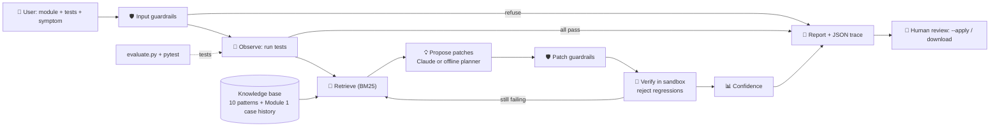

# 🕵️ Glitch Investigator: a RAG debugging agent that verifies its own fixes

**Glitch Investigator** takes a buggy Python module, its pytest file, and a symptom in plain words ("my score went up after a wrong guess"). It then:

1. **looks up** matching bug patterns in a knowledge base, including the real bugs from my Module 1 project,
2. **proposes** small patches based on what it retrieved,
3. **runs the tests** on each patch in a sandbox and throws away anything that breaks a passing test,
4. **repeats** on whatever still fails,
5. **reports** a diagnosis, a diff, and a confidence score, and leaves the final decision to a human.

It never edits your file on its own. If it can't *prove* a fix with your tests, it says so and hands the problem to a person.

> **Why it matters:** AI coding assistants often produce code that *looks* right. My Module 1 project was literally a game "an AI claimed was production-ready" that had 7 bugs. This project turns that lesson into a system: an AI that has to show evidence (retrieved precedent + passing tests) before it is allowed to call something fixed.

---

## 📦 Base project

This extends my **Game Glitch Investigator** from AI110 Module 1 ([original repo](https://github.com/Pamzlerinz/ai110-module1show-gameglitchinvestigator-starter)). The Module 1 version is on that repo's `main` branch; this project is on its `applied-ai-system` branch.

The original was a Streamlit number-guessing game, deliberately written with AI-introduced bugs: hints pointed the wrong way, the secret flipped between `int` and `str`, "New Game" left the player stuck, and the score went *up* on wrong guesses. My job was to find and fix those bugs by hand, move the logic into `logic_utils.py`, and lock the fixes in with 14 pytest tests. The fixed game is still here (`app.py`). Its bug log became the agent's case-history knowledge source, and its fixed logic is one of the evaluation cases.

---

## 🏗️ Architecture overview

Diagram source: [diagrams/architecture.mmd](diagrams/architecture.mmd) (Mermaid).



| Component | File | Role |
|---|---|---|
| Retriever | `glitch_agent/retriever.py` | BM25 over two sources: `knowledge_base/patterns/*.md` (10 bug patterns, each with a symptom, root cause, fix recipe, and named repair strategy) and `knowledge_base/case_history.md` (6 real bugs from Module 1). The query is the symptom plus the failing test names and assertion messages. |
| Agent loop | `glitch_agent/agent.py` | Plan → validate → observe → retrieve → propose → guardrail → verify → iterate → score → report. It logs every step to `logs/glitch_agent.log` and saves a JSON trace per run. |
| Backends | `glitch_agent/backends.py` | **Claude** (`claude-opus-5-5`, structured JSON output: diagnosis, pattern id, confidence, patched file) when `ANTHROPIC_API_KEY` is set. Otherwise an **offline planner** that runs the repair strategy of each *retrieved* pattern. If Claude errors or refuses, the agent falls back to the offline planner. |
| Repairs | `glitch_agent/repairs.py` | 8 small AST-guided edit strategies (swap hint wording, remove a `str()` cast, flip a sign, fix a boundary, complete a state reset, and so on). Each edit is spliced into the original text so comments survive. |
| Sandbox | `glitch_agent/sandbox.py` | Copies the module + tests into a temp dir and runs pytest in a subprocess with a 30 s timeout. |
| Guardrails | `glitch_agent/guardrails.py` | **Input:** size, syntax, banned imports/calls (`os`, `subprocess`, `eval`, `open`, ...), and the tests must import the target. **Patch:** must parse, add no banned ops, delete no functions, and change ≤ 20 lines. |
| Interfaces | `investigate.py`, `pages/1_Glitch_Agent.py` | CLI and Streamlit page (runs alongside the original game in `app.py`). |
| Evaluation | `evaluate.py`, `eval/cases/`, `tests/` | 11 scenario cases with expected outcomes, RAG ablations, and 39 pytest tests. |

**Where humans and testing come in:** the user's own tests are the oracle for every candidate. The evaluation harness checks the agent's *behaviour* (fix, refuse, or escalate). And a human makes the final call on every patch: nothing is written without `--apply`, and only results with confidence ≥ 0.75 can be applied.

---

## ⚙️ Setup

Requires Python 3.10+ (developed on 3.14, Windows 11).

```bash
git clone -b applied-ai-system https://github.com/Pamzlerinz/ai110-module1show-gameglitchinvestigator-starter.git
cd ai110-module1show-gameglitchinvestigator-starter
python -m venv .venv
# Windows: .venv\Scripts\activate    macOS/Linux: source .venv/bin/activate
pip install -r requirements.txt
```

**Optional: use Claude as the reasoning backend.** Without a key, everything runs offline and deterministically.

```bash
export ANTHROPIC_API_KEY=sk-ant-...        # PowerShell: $env:ANTHROPIC_API_KEY="sk-ant-..."
```

**Run it:**

```bash
# Investigate a buggy module (proposes a fix, changes nothing)
python investigate.py eval/cases/03_score_sign/game.py --tests eval/cases/03_score_sign/test_game.py \
    --symptom "My score went up after a wrong guess." --trace

# Apply a verified fix (keeps game.py.bak)
python investigate.py path/to/game.py --tests path/to/test_game.py --apply

# Web UI: the original game + the Glitch Agent page
python -m streamlit run app.py

# Tests and evaluation
python -m pytest
python evaluate.py --compare
```

CLI flags: `--backend auto|offline|claude`, `--no-retrieval` (ablation), `--trace` (print each agent step), `--verbose` (echo logs).

---

## 💬 Sample interactions

All outputs below come from real runs with the offline backend. The full logs are in [assets/sample_runs/](assets/sample_runs/).

**Execution evidence at a glance**

| What a grader needs to see | Where it is |
|---|---|
| End-to-end runs on different inputs | Sample interactions 1–4 below: four different buggy modules and symptoms, each with its command and full output |
| AI feature behaviour (RAG + agent) | Interaction 1 (retrieved patterns and the step-by-step agent trace) and interaction 2 (three planning iterations, retrieving again each time) |
| Reliability and guardrails | Interaction 3 (dangerous input refused), interaction 4 (missing feature handed to a human), and the [Testing summary](#-testing-summary-reliability-and-guardrail-results) (evaluation harness + pytest) |
| Clear outputs per case | Every run shows its status, confidence, test counts and diff; per-case evaluation table in [eval/results.md](eval/results.md) |

### 1. A single bug, with the full agent trace (RAG → patch → verify)

```text
$ python investigate.py eval/cases/01_inverted_hints/game.py --tests eval/cases/01_inverted_hints/test_game.py --symptom "The hint says go higher even though my guess was way too high." --trace

✅ STATUS: fixed   confidence=1.0
   All tests pass after 1 verified change(s).
   backend: offline-heuristic
   tests: 2/4 passed -> 4/4 passed   (iterations=1, candidates tested=1)
   retrieved patterns: inverted-hint (1.0), reversed-comparison (0.341), type-mismatch-comparison (0.231)
   diagnosis: Inverted hint direction: The outcome labels ("Too High", "Too Low") are correct but the user-facing messages attached to them are swapped, usually inside a HINT_MESSAGES dictionary or an if/else that returns message strings.

--- proposed patch --------------------------------------------------
--- a/game.py
+++ b/game.py
@@ -1,7 +1,7 @@
 HINT_MESSAGES = {
     "Win": "🎉 Correct!",
-    "Too High": "📈 Go HIGHER!",
-    "Too Low": "📉 Go LOWER!",
+    "Too High": "📉 Go LOWER!",
+    "Too Low": "📈 Go HIGHER!",
 }

--- agent trace -----------------------------------------------------
   1. plan     backend=offline-heuristic retrieval=True plan: validate input -> run tests -> retrieve bug patterns -> propose patches -> guardrail-check + verify each patch -> iterate on remaining failures -> score confidence and report for human approval
   2. validate ok=True
   3. observe  tests 2/4 passed; failing: test_hint_tells_player_to_go_lower_when_too_high, test_hint_tells_player_to_go_higher_when_too_low
   4. retrieve top chunks: patterns:inverted-hint (52.81); case_history:inverted-hint (36.91); patterns:inverted-hint (33.65); patterns:reversed-comparison (18.02) => patterns: inverted-hint (1.0), reversed-comparison (0.341), type-mismatch-comparison (0.231)
   5. propose  iteration 1: 2 candidate patch(es)
   6. verify   [inverted-hint] swap HIGHER/LOWER wording in 2 string literal(s) => 4/4 passed
   7. accept   iteration 1: keep [inverted-hint] swap HIGHER/LOWER wording in 2 string literal(s) (4/4 passed)
   8. report   status=fixed, confidence=1.0, message=All tests pass after 1 verified change(s).
```

### 2. The original Module 1 glitches, all at once (multi-step agent)

Three overlapping bugs. The agent fixes one per iteration and re-retrieves for the remaining failures each time. Full trace with every candidate it rejected: [assets/sample_runs/08_multi_bug.txt](assets/sample_runs/08_multi_bug.txt).

```text
$ python investigate.py eval/cases/08_multi_bug/game.py --tests eval/cases/08_multi_bug/test_game.py --symptom "The original glitchy game: hints lie, score goes up when I am wrong, and 9 vs 50 says Too High."

✅ STATUS: fixed   confidence=0.95
   All tests pass after 3 verified change(s).
   backend: offline-heuristic
   tests: 0/3 passed -> 3/3 passed   (iterations=3, candidates tested=15)
   retrieved patterns: score-sign-error (1.0), type-mismatch-comparison (0.821), inverted-hint (0.736)
   diagnosis: Score sign error on wrong guesses: An arithmetic operator has the wrong sign: a penalty is written as current_score + 5 instead of current_score - 5, often inside one branch of an if statement on attempt_number parity.
   diagnosis: Inverted hint direction: The outcome labels ("Too High", "Too Low") are correct but the user-facing messages attached to them are swapped, usually inside a HINT_MESSAGES dictionary or an if/else that returns message strings.
   diagnosis: Type mismatch in comparison (str vs int): One side of the comparison is converted to a string with str() before comparing with an integer.

--- proposed patch --------------------------------------------------
--- a/game.py
+++ b/game.py
@@ -1,4 +1,4 @@
-HINT_MESSAGES = {"Win": "🎉 Correct!", "Too High": "📈 Go HIGHER!", "Too Low": "📉 Go LOWER!"}
+HINT_MESSAGES = {"Win": "🎉 Correct!", "Too High": "📉 Go LOWER!", "Too Low": "📈 Go HIGHER!"}
 
 
 def check_guess(guess, secret):
@@ -20,11 +20,9 @@
 def submit_guess(state, guess):
     state["attempts"] += 1
     secret = state["secret"]
-    if state["attempts"] % 2 == 0:
-        secret = str(secret)
     outcome = check_guess(guess, secret)
     if outcome == "Too High" and state["attempts"] % 2 == 0:
-        state["score"] = state["score"] + 5
+        state["score"] = state["score"] - 5
     elif outcome != "Win":
         state["score"] = state["score"] - 5
     return outcome, HINT_MESSAGES[outcome]
```

### 3. Guardrail: dangerous input is refused before anything runs

```text
$ python investigate.py eval/cases/10_dangerous_input/game.py --tests eval/cases/10_dangerous_input/test_game.py --symptom "The game crashes on startup."

⛔ STATUS: refused   confidence=0.0
   Refused: target file uses operations the sandbox will not run: import os
   backend: offline-heuristic
(exit code 1)
```

### 4. Knowing its limits: a missing feature is escalated, not invented

```text
$ python investigate.py eval/cases/11_missing_feature/game.py --tests eval/cases/11_missing_feature/test_game.py --symptom "I want a Very close hint when the guess is within 5 of the secret."

🧑‍🔧 STATUS: needs_human_review   confidence=0.0
   No verified fix. The failing tests do not match any repair the agent could confirm; a human should investigate.
   backend: offline-heuristic
   tests: 2/3 passed -> 2/3 passed   (iterations=1, candidates tested=0)
   retrieved patterns: inverted-hint (1.0), type-mismatch-comparison (0.844)
   still failing: test_very_close_hint
(exit code 1)
```

---

## 🧪 Testing summary (reliability and guardrail results)

**Automated tests:** `python -m pytest`

```text
$ python -m pytest -v
...
tests/test_game_logic.py::test_too_high_always_deducts_points PASSED     [ 74%]
tests/test_game_logic.py::test_too_low_deducts_points PASSED             [ 76%]
tests/test_game_logic.py::test_win_score_rewards_attempts_left PASSED    [ 79%]
tests/test_game_logic.py::test_win_on_last_attempt_still_scores_positive PASSED [ 82%]
tests/test_game_logic.py::test_win_score_never_drops_below_base PASSED   [ 84%]
tests/test_game_logic.py::test_parse_guess_rejects_empty_input PASSED    [ 87%]
tests/test_game_logic.py::test_parse_guess_rejects_non_numeric_string PASSED [ 89%]
tests/test_game_logic.py::test_parse_guess_accepts_negative_numbers PASSED [ 92%]
tests/test_game_logic.py::test_parse_guess_accepts_decimal_strings PASSED [ 94%]
tests/test_game_logic.py::test_parse_guess_accepts_very_large_numbers PASSED [ 97%]
tests/test_game_logic.py::test_range_for_easy_difficulty PASSED          [100%]

============================= 39 passed in 26.38s =============================
```

**Evaluation harness:** `python evaluate.py --compare` runs all 11 cases under 3 retrieval configurations. A case passes only if the agent reaches the *expected behaviour*: fix it with the right pattern, refuse it, report "no bug", or escalate to a human. Per-case table: [eval/results.md](eval/results.md).

```text
$ python evaluate.py --compare
== config: rag_full ==
  [PASS] 01_inverted_hints      expected=fixed               got=fixed               conf=1.0   candidates=1
  [PASS] 02_type_mismatch       expected=fixed               got=fixed               conf=1.0   candidates=1
  [PASS] 03_score_sign          expected=fixed               got=fixed               conf=1.0   candidates=4
  [PASS] 04_attempt_counter     expected=fixed               got=fixed               conf=1.0   candidates=7
  [PASS] 05_incomplete_reset    expected=fixed               got=fixed               conf=1.0   candidates=1
  [PASS] 06_boundary_check      expected=fixed               got=fixed               conf=1.0   candidates=3
  [PASS] 07_mutable_default     expected=fixed               got=fixed               conf=1.0   candidates=1
  [PASS] 08_multi_bug           expected=fixed               got=fixed               conf=0.95  candidates=15
  [PASS] 09_already_fixed       expected=no_bug_detected     got=no_bug_detected     conf=1.0   candidates=0
  [PASS] 10_dangerous_input     expected=refused             got=refused             conf=0.0   candidates=0
  [PASS] 11_missing_feature     expected=needs_human_review  got=needs_human_review  conf=0.0   candidates=0
...
== summary ==
  rag_full           passed 11/11 | tests green 8/8 | auto-accepted 8/8 | wrong-pattern fixes 0 | avg confidence 0.99 | avg candidates 4.1 | hit@1 8/8 | recall 1.0
  rag_patterns_only  passed 10/11 | tests green 8/8 | auto-accepted 8/8 | wrong-pattern fixes 1 | avg confidence 0.98 | avg candidates 3.4 | hit@1 8/8 | recall 1.0
  no_retrieval       passed 3/11 | tests green 8/8 | auto-accepted 0/8 | wrong-pattern fixes 2 | avg confidence 0 | avg candidates 10.6 | hit@1 n/a | recall n/a

Wrote eval\results.md
```

**In short:** with full RAG, 11/11 cases behave as expected, and average confidence on accepted fixes is 0.99. Retrieval cut the candidate patches tested from 10.6 to 4.1 per case. Its biggest benefit was *correctness*: without the case-history source, the agent made a three-bug case pass its tests with the **wrong** patch. Blind search made the tests pass in every fixable case, but two of those patches were wrong. One changed `attempt_number % 2` to `% 3` just to dodge the attempt numbers the tests use. None of them earned enough confidence to auto-accept, which is what I want from a system that can't explain its patch.

**RAG improvement (before/after).** On `08_multi_bug`, indexing only the pattern docs let a fourth pattern, "reversed comparison", into the retrieved set. One of its candidates flipped `>` to `<` in a fallback branch and jumped from 0/3 to 2/3 passing tests in a single step, so the greedy search kept it. After the hint fix, all 3 tests were green, but the real `str()` bug was still in place, and the confidence score (0.88) did not flag it. ([trace](assets/sample_runs/08_multi_bug_patterns_only_trace.txt)) With the Module 1 case history added as a second source ("Guess of 9 said Too High against a secret of 50 … `str(st.session_state.secret)`"), the top retrieved chunks are all about the real patterns, the misleading one drops out, and the agent removes the `str()` cast instead ([trace](assets/sample_runs/08_multi_bug.txt)). Same tests, but now the correct fix. Details are in [model_card.md](model_card.md).

What I learned: green tests are necessary but not sufficient. The evaluator has to check *why* a fix works, and the agent's confidence has to depend on evidence beyond "tests pass".

---

## 🧭 Design decisions and trade-offs

- **Tests as the oracle, not the model's word.** Every patch, from Claude or the planner, has to pass the user's unmodified tests without regressions. *Trade-off:* the system is only as good as the tests, and it can't help with untested code.
- **Two backends, one interface.** Claude gives open-ended diagnosis. The offline planner makes everything reproducible for free and turns retrieval into a measurable ablation. *Trade-off:* the offline planner only knows 8 bug shapes.
- **BM25 instead of embeddings.** It has no extra dependencies, needs no API, and is easy to inspect (you can see which words matched). *Trade-off:* it has no synonyms, so symptoms phrased very differently retrieve worse.
- **Greedy, regression-free hill-climbing.** It's simple and fast, and each step can be explained. *Trade-off:* it can lock in a coincidentally passing patch (the case above), which is why confidence includes retrieval support.
- **Text-splice edits instead of `ast.unparse`.** Patches keep comments and formatting, so diffs stay minimal and reviewable.
- **Refuse rather than sandbox harder.** A static banned-operation check before running anything is cheap and understandable. It is not a real security boundary, and the model card says so.

---

## 🪞 Reflection

Module 1 taught me not to trust AI-written code just because it looks finished. Building this agent taught me the same thing from the other side: when *I* am the one building the AI, my job is to design the checks that keep it honest. The most valuable result in this project is the wrong-but-green patch, because it showed that "the tests pass" and "the bug is fixed" are different claims. I also learned that retrieval is not just a way to give a model more information. It is a way to make the system *justify* its output with precedent, and that justification can be measured. Responsible-AI reflection, limitations, future improvements, and AI-collaboration notes: **[model_card.md](model_card.md)**. Agent reasoning traces: **[ai_interactions.md](ai_interactions.md)**.

### Portfolio note: what this project says about me as an AI engineer

**Code:** https://github.com/Pamzlerinz/ai110-module1show-gameglitchinvestigator-starter/tree/applied-ai-system

I build AI systems that have to earn trust: they show their evidence, measure themselves, and know when to hand a problem to a person. In this project I treated the AI's answers as hypotheses to verify, and I reported the uncomfortable result (a passing-but-wrong patch) instead of hiding it.

---

## 📁 Repository map

```
app.py                     the fixed Module 1 game (Streamlit), restyled + link to the agent page
logic_utils.py             fixed Module 1 game logic
pages/1_Glitch_Agent.py    Streamlit UI for the agent
investigate.py             CLI
evaluate.py                evaluation harness (pass/fail, confidence, RAG ablations)
glitch_agent/              agent, retriever, backends, repairs, sandbox, guardrails
knowledge_base/            pattern docs + Module 1 case history (RAG sources)
eval/cases/                11 scenario cases; eval/results.md = latest results
tests/                     game-logic tests (Module 1) + agent tests
diagrams/architecture.mmd  system diagram (Mermaid source)
assets/sample_runs/        captured command outputs (execution evidence)
model_card.md              limitations, misuse, testing, AI collaboration
ai_interactions.md         agent reasoning traces
reflection.md              original Module 1 reflection
```
